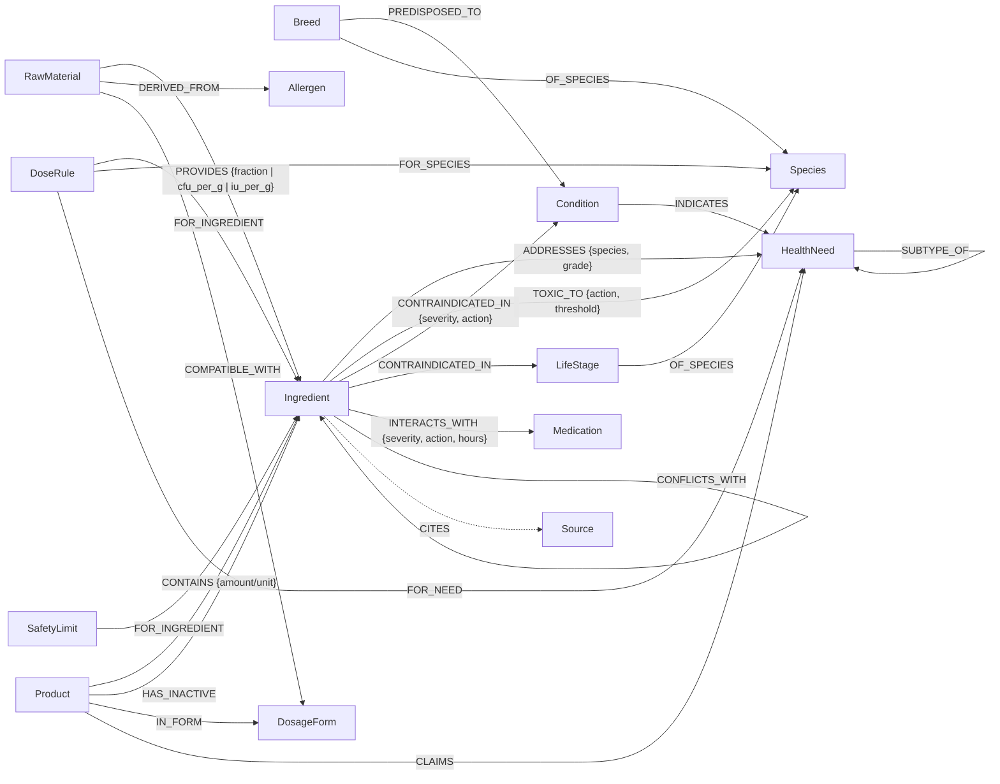

# Supplement Knowledge Graph: design note

This graph serves step 2 of the pipeline ("Choosing the formula"). Step 1 hands over a pet profile with a
list of health needs. Step 2 answers four questions against this graph, in order, using no LLM:

1. Which ingredients address each need, for this species?
2. Which of those are unsafe for this animal?
3. How much of each, from body weight, within fixed limits?
4. Can the result be manufactured, and is there a product on the market that already does it?

## Principles

- **Population knowledge only.** The graph says what ingredients do, at what dose, and when they are unsafe.
  Individual pet records stay in the operational database and reach the engine as a `PetProfile`.
- **Deterministic and versioned.** The same profile and the same graph version always give the same formula.
  Every formula records the graph's content hash (`kg_version`), so any past formula can be reproduced.
- **Every fact is sourced and curated.** Each edge, dose rule and safety limit has `sources` (PMID, DOI, label
  URL or regulation) and a `curation` status: `draft`, then `reviewed`, then `vet_approved`. The loader rejects
  any edge without a source. Rules that rest only on reasoning cite `source:freyja_curator_reasoning`, so the
  gap stays visible.
- **Negative evidence is kept.** Glucosamine for joints, glucosamine for feline cystitis, and lysine for feline
  herpes have `grade: NEG` edges. The engine never formulates them, and step 3 can explain why they were left out.
- **Wrong exclusions are cheaper than wrong inclusions.** Ambiguous safety records become vet-review flags, never
  silent passes.
- **The LLM never writes to the graph at runtime.** LLMs helped with the research that seeded it. Every change
  after that is a reviewed pull request against the YAML.

## Schema

### Nodes

| Type | Count | What it is | Key properties |
|---|---|---|---|
| `Species` | 2 | dog, cat | metabolic exponent, species notes (e.g. cat UGT1A6 deficiency) |
| `Breed` | 24 | dog and cat breeds | size class, adult weight range |
| `LifeStage` | 14 | AAHA/AAFP stages, by dog size class | age window |
| `Condition` | 39 | diagnoses and physiological states | category, `physiological_state` (e.g. pregnancy) |
| `HealthNeed` | 15 | **the unit of formulation**; step 1 produces these | parent need, customer-facing label |
| `Ingredient` | 70 | what doses and safety rules are written about | `kind` (active, excipient or hazard), `dose_unit`, `regulatory_status` |
| `RawMaterial` | 39 | what is actually bought and blended | potency, allergen source, heat/moisture/light limits, compatible forms, overage |
| `DosageForm` | 9 | soft chew, tablet, capsule, sachet, oil, softgel, enteric tablet | unit mass, active and oil load, process temperature, per-species unit and mass limits |
| `Medication` | 24 | drug **classes** | examples |
| `Allergen` | 11 | beef, chicken, fish, shellfish, ... | – |
| `Product` | 30 | in-market product variants | actives per unit, weight-band dosing, inactives of note, label URL, verification level |
| `Source` | 343 | citations | type, PMID/DOI/URL, year |

### Edges and reified facts

| Relation | Count | Meaning | Engine use |
|---|---|---|---|
| `ADDRESSES` | 68 | ingredient helps a need **in one species** | candidates; grade A/B/C/D/NEG weights the selection |
| `INDICATES` | 19 | condition implies a need | bridge for the step-1 rules |
| `PREDISPOSED_TO` | 103 | breed risk | precautionary safety (`applies_to_predisposition`) |
| `TOXIC_TO` | 38 | species hazard | `exclude` removes; `vet_review` and `dose_cap` raise a flag |
| `CONTRAINDICATED_IN` | 74 | unsafe in a condition or life stage | `exclude` removes; `reduce_dose` caps; `vet_review` and `monitor` raise a flag |
| `INTERACTS_WITH` | 73 | drug–supplement interaction | `exclude`; `separate_dosing` (N hours); `monitor` |
| `CONFLICTS_WITH` | 10 | ingredient–ingredient issue | `avoid_combination` blocks co-selection |
| `DoseRule` | 46 | daily amount per species and, optionally, per need | per kg, per kg^0.75, per animal, or weight band |
| `SafetyLimit` | 4 | hard ceiling (NRC safe upper limit, company policy) | clips the dose; if the minimum is unreachable, the ingredient is dropped |

## Modelling decisions and why

1. **Ingredient vs raw material.** Doses and evidence are about the active (EPA+DHA in mg, SAMe as the ion,
   colony-forming units for probiotics). Purchasing and manufacturing are about raw materials (60% fish-oil
   concentrate; SAMe tosylate, which is 50% SAMe and needs an enteric coat). Keeping them separate lets one rule
   ("EPA+DHA 310 mg/kg^0.75") work with any source. It also lets allergen screening work at the right level:
   glucosamine is not a shellfish problem, but crab-derived glucosamine is.
2. **Evidence edges are per species.** Probiotic and dosing results do not transfer between dogs and cats,
   or even between strains. The graph has one `ADDRESSES` edge per species, not one per ingredient.
3. **Dose rules and safety limits are nodes, not edge properties.** Each needs its own citations, curation
   status and stable ID, so a formula can say "dose:omega3_dog_joint gave 3,874 mg" and the explanation step
   can cite it.
4. **Efficacy range is separate from the safety ceiling.** The rule's `max` is the top of the studied range.
   `SafetyLimit` is the safety bound. Products are only flagged against safety ceilings.
5. **Breed predispositions can trigger precaution.** A Bedlington Terrier with no diagnosis still never gets
   copper. Labradors, Dobermans, Westies and Dalmatians get the same copper screen, and Dalmatians are also
   screened for purines (urate stones).
6. **Interactions are curated at drug-class level.** Step 1 maps "Rimadyl 75 mg" to `med:nsaid`, which keeps
   the interaction table small and reviewable.
7. **YAML in git is the source of truth; Neo4j is a projection.** At about 1,000 facts, reviewable diffs and CI
   validation matter more than query power. `python -m kg export cypher` builds a Neo4j load script for
   exploration. Revisit if the graph passes about 50k facts or needs a multi-user editing UI.

## How step 2 runs (`kg/formulate.py`)

1. **Context.** Work out the life stage (from breed size class or weight) and the breed predispositions.
2. **Candidates.** Collect `ADDRESSES` edges for the species where the need was requested and the grade is at
   least C (configurable).
3. **Safety screen.** Apply species toxicity, condition and life-stage contraindications (including
   precautionary predisposition rules), and medication interactions. Then pick a raw material that avoids the
   pet's allergens; if none exists, the ingredient is dropped.
4. **Selection.** Weighted greedy set cover. Gain = evidence grade x need priority. Primary needs get up to two
   ingredients; ingredient pairs marked `CONFLICTS_WITH` + `avoid_combination` are never co-selected.
5. **Dose.** Use the need-specific rule if one exists, otherwise the general rule, and take the highest target.
   Clip to the lowest safety ceiling (and to any relative-contraindication cap). Drop the ingredient if the
   ceiling falls below the rule minimum. Dose on `ideal_weight_kg` when it is given.
6. **Manufacture.** Convert to raw-material mass (potency and overage), then search single forms and kits of up
   to 3 forms. Each kit must respect process temperature, oil and active load, and the per-species limits on
   units and daily mass (e.g. no more than 2 g/day of powder for cats).
7. **Product match.** For each product, compute the daily amount at the pet's weight band and compare it with
   the formula targets. Score 0 if the product contains anything excluded for this pet, an allergen, or a hazard
   that is screened for this pet (e.g. brewer's yeast for a urate former, green tea extract in liver disease).

The output (`Formula`) lists every edge it used (`facts_used`), every source (`sources_used`), each calculation
step, every exclusion with its reason, flags for the vet, unmet needs, and negative-evidence items.

## Interfaces with the other steps

- **Step 1 → step 2.** `PetProfile` contains species, breed, age, weight, ideal weight, conditions, medication
  classes, allergens, and needs with priorities. The `INDICATES` edges give step 1's rules a sourced
  condition-to-need mapping. Rules from lab values (e.g. cobalamin below the reference range, so
  `need:cobalamin_repletion`) live in step 1.
- **Step 2 → step 3.** The explanation step gets the `Formula` and is only allowed to use `Fact.statement`
  strings and the cited sources. A check after generation can confirm that every claim maps to a `facts_used`
  ID.
- **Step 4 → graph.** Vet edits and outcomes should not update edges directly. They are aggregated into
  `source:internal_*` records, of type `internal`, which a curator can cite when changing a grade or dose.
  Vet edits that keep recurring (e.g. "always halves omega-3 in pancreatitis") are the main signal for which
  rules to revisit.

## Content status (2026-10-03)

All **435 facts are `draft`**. They were collected from the literature in one research pass. PMIDs and DOIs were
checked against PubMed for author and year, but **no veterinarian has reviewed them yet**. The raw research
notes, with per-value verification tags, are in `research/`.

**Firmest:** omega-3 dosing and the NRC safe upper limit; the ACVIM hepatitis doses (SAMe, silybin, vitamin E);
oral cobalamin protocols; species toxicities (xylitol, alpha-lipoic acid in cats, propylene glycol in cats,
allium, 5-HTP); copper/purine breed rules; mineral and fluoroquinolone/doxycycline chelation; bromide and
chloride; product labels confirmed on manufacturer pages (24 of 30 product variants).

**Weakest, to fix before production:**
- Manufacturing envelopes are rules of thumb: soft-chew 35% active load, chewable-tablet load, pump volume,
  probiotic CFU/g and 2x overage, and cat powder/oil acceptance. Replace them with the contract manufacturer's
  specs.
- Several cat doses are derived from therapeutic diets (omega-3 for CKD and joints). There are no verified cat
  doses for green-lipped mussel, curcumin, cranberry or carnitine. The engine reports those as unavailable rather
  than guessing.
- Most drug-interaction and some condition rules rest on human data or mechanism (`evidence_strength` on each
  edge). The fish oil–NSAID and fish oil–bleeding evidence is weak, so those are `monitor`, not `exclude`.
- EPA and DHA are modelled as one active. Algal (DHA-only) oil is a fish-free fallback that should prompt vet
  review.
- Ten "safe in" records (e.g. omega-3 is *recommended* in hyperlipidaemia and mitral valve disease) were kept
  out of the filter. They should become a `SAFE_IN` edge, so the explanation step can say so and stop
  conflicting relative rules from over-flagging.

## Open questions for the team

1. **Vet review workflow.** Who signs off curation, and is `vet_approved` required for every edge the engine
   uses, or only for safety edges?
2. **Diet awareness.** Safe upper limits apply to diet plus supplement. Should step 1 capture the diet (brand,
   or omega-3 content) so the engine can subtract it?
3. **Selection objective.** Greedy evidence-weighted coverage ignores cost, palatability and unit count. Do we
   want an optimiser (ILP) once raw-material costs are in?
4. **Base matrix allergens.** Soft-chew palatants are usually liver or animal digest. Should `DosageForm` carry
   palatant options so allergic pets get a compatible base?
5. **Product matching.** Single products only for now. Is recommending a *combination* of in-market products in
   scope?
6. **Regulatory.** CBD/hemp is excluded (`not_permitted`). The new federal hemp definition takes effect
   12 Nov 2026; recheck it then.
